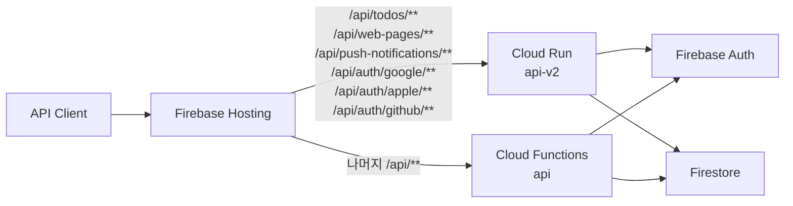

# DevLog_Firebase

DevLog의 Firebase Cloud Functions와 Firestore index 설정을 관리하는 저장소입니다.

## 구성

- `firebase.json`: Firebase Functions, Firestore index, emulator 설정
- `firebase.test.json`: 테스트용 Firebase emulator 설정
- `firestore.index.json`: Firestore composite index 설정
- `functions`: Cloud Functions TypeScript 소스
- `nestjs-api`: Cloud Run용 NestJS API 소스와 Docker 이미지 구성

## 백엔드 요청 구조

이 저장소는 기존 Cloud Functions와 별도로 배포할 수 있는 NestJS API를 함께 관리합니다. Firebase Hosting rewrite는 요청 경로에 따라 Cloud Run과 Cloud Functions로 HTTP 요청을 분기합니다.



| 실행 구성 | 소스 | 책임 |
| --- | --- | --- |
| Firebase Hosting | `firebase.json` | 공개 요청 진입점과 경로별 rewrite 순서 관리 |
| Cloud Run `api-v2` | `nestjs-api` | Todo, WebPage, PushNotification 요청의 Firebase ID Token 검증과 삭제, Google·Apple·GitHub 인증 관리 |
| Cloud Functions `api` | `functions` | Staging의 나머지 `/api/**` 요청에 대한 `404` 응답 경계 유지 |
| Cloud Functions 개별 함수 | `functions` | trigger, Scheduler, Cloud Tasks, FCM 처리 |
| Firebase Auth | — | 인증이 필요한 경로에 전달된 Bearer token 검증 |
| Firestore | — | 검증된 사용자 UID 범위의 공통 데이터 저장 |

Staging Hosting에서는 `/api/todos/**`, `/api/web-pages/**`, `/api/push-notifications/**`, `/api/auth/google/**`, `/api/auth/apple/**`, `/api/auth/github/**`를 Cloud Run `api-v2`가 우선 처리합니다. 나머지 `/api/**`는 Functions `api`가 `404` 응답 경계를 유지합니다.

기존 Functions를 한 번에 교체하지 않고 요청 계약을 유지하면서 경로 단위로 NestJS API에 이전하는 구조입니다. 최종적으로 Cloud Functions `api`가 담당하는 HTTP API 전체를 Cloud Run 기반 `api-v2`로 이전하는 것을 목표로 합니다.

Cloud Run 배포와 직접 호출 검증은 [`docs/cloud-run-staging.md`](docs/cloud-run-staging.md), Firebase Hosting 분기 배포와 복구는 [`docs/firebase-hosting-staging.md`](docs/firebase-hosting-staging.md)에서 관리합니다.

## Crashlytics 오류 분석과 자동 수정

`sendDailyIncidentReport`는 매일 09:00(Asia/Seoul)에 전날 Crashlytics 오류를 분석해 Discord로 요약하고, 서버에서 간단히 고칠 수 있는 오류는 GitHub 이슈와 Draft PR로 이어 주는 Cloud Function입니다. 소스는 `functions/src/incident`에 있습니다.

### 처리 흐름

1. Crashlytics BigQuery 실시간 내보내기 테이블에서 신규, 급증, 회귀 오류를 이슈와 상태 코드 단위로 최대 10개 고릅니다.
2. 스택, 이벤트, `api-v2` 서버 로그, GitHub에서 읽은 앱과 서버 코드 조각을 모으고 토큰, 이메일, IP를 마스킹합니다.
3. 규칙으로 고칠 위치를 서버, iOS, 공동 중 하나로 정합니다. REST 응답이 없는 오류는 iOS로 분류합니다.
4. OpenAI 모델이 판단마다 근거를 인용한 JSON을 내고, 코드가 인용한 원문을 검증한 뒤 위험도를 계산합니다. 알림 등급은 영향도와 심각도 중 큰 값입니다.
5. 분석한 모든 오류를 Discord 요약으로 보냅니다. 등급 2 이상 상위 5건은 상세로, 나머지는 한 줄로 표시합니다.
6. 자동 수정 자격이 있는 오류만 이 저장소에 `auto-fix` 라벨이 붙은 이슈로 만듭니다. 같은 오류의 열린 이슈가 있으면 댓글로 갱신합니다.
7. `.github/workflows/auto-fix.yml`이 `auto-fix` 라벨이 붙은 이슈를 Codex로 수정하고 Draft PR을 올립니다. 머지는 사람이 합니다.

자동 수정 자격이 없는 오류는 이슈를 만들지 않고 Discord 요약에서 끝납니다.

### 자동 수정 자격

다음 조건을 모두 만족해야 합니다.

- 고칠 위치가 서버로 분류됨
- 수정 유형이 `statusCodeMapping`, `inputValidation`, `nullGuard`, `exceptionHandling`, `errorResponse`, `responseDefault`, `timeoutRetry` 중 하나
- 수정 파일이 모두 `functions/src`, `functions/test`, `nestjs-api/src`, `nestjs-api/test` 안에 있음
- 변경 위험과 불확실성이 모두 1 이하
- 데이터 손실과 보안 문제가 없다는 판단에 근거가 있음

수정 워크플로는 변경이 300줄을 넘거나 `.github`, 인증 코드, 설정, 의존성 파일을 건드리면 PR을 만들지 않고 이슈에 사유를 댓글로 남깁니다. 같은 이름의 브랜치(`auto-fix/issue-<번호>`)가 이미 있으면 PR을 만들지 않습니다.

### 필요한 설정

| 이름 | 사용하는 곳 | 용도 |
| --- | --- | --- |
| `OPENAI_API_KEY` | Cloud Functions Secret, Actions secret | 분석 호출과 Codex 수정 |
| `DISCORD_WEBHOOK_URL` | Cloud Functions Secret | 일일 요약 전송 |
| `GH_AUTOMATION_TOKEN` | Cloud Functions Secret, Actions secret | 이슈 생성, 코드 읽기, 수정 브랜치와 PR 생성 |

`GH_AUTOMATION_TOKEN`은 이 저장소의 Issues, Contents, Pull requests 쓰기와 iOS 저장소의 Contents 읽기 권한을 가진 fine-grained token을 사용합니다.

함수 실행 서비스 계정에는 Crashlytics 데이터셋 조회, BigQuery 작업 실행, Cloud Logging 조회 권한이 필요합니다.

### 수동 실행

Cloud Scheduler 작업을 직접 실행해 하루 분량을 즉시 처리할 수 있습니다. 같은 날 연달아 실행하면 방금 만든 이슈가 목록 조회에 늦게 반영되어 같은 오류의 이슈가 중복으로 생길 수 있습니다.

```bash
gcloud scheduler jobs run firebase-schedule-sendDailyIncidentReport-asia-northeast3 \
  --project <project-id> \
  --location asia-northeast3
```

## 환경 변수

Firebase CLI의 `--project`로 staging 또는 prod Firebase project를 선택합니다. 각 project에 배포된 함수는 인자 없는 `getFirestore()`로 해당 project의 `(default)` database를 사용합니다.

일반 환경 변수를 추가하면 Firebase CLI가 `functions/.env`와 선택한 project 또는 alias에 대응하는 `functions/.env.<project or alias>`를 자동으로 읽습니다.

일반 환경 변수 파일은 로컬 전용으로 관리하며 Git에 포함하지 않습니다.

GitHub, Google, Apple 인증 설정은 일반 환경 변수나 `.env`에 저장하지 않고 Firebase project별 Secret Manager의 `GITHUB_OAUTH_CONFIG`, `GOOGLE_OAUTH_CONFIG`, `APPLE_AUTH_CONFIG` JSON Secret에서 각각 관리합니다.

GitHub JSON에는 `clientId`, `clientSecret`, `callbackURL` 필드를 모두 포함합니다.

Google JSON에는 `clientId`, `clientSecret` 필드를 필수로 포함합니다. `callbackURL`은 사용하지 않습니다.

Google `clientSecret`은 같은 환경의 `GOOGLE_OAUTH_CONFIG.clientId`에 대응하는 Web OAuth client에서 발급된 값이어야 합니다.

iOS Google Sign-In 설정은 환경별 Firebase Secret과 다음과 같이 일치해야 합니다.

- staging `GIDServerClientID` = staging `GOOGLE_OAUTH_CONFIG.clientId`
- production `GIDServerClientID` = production `GOOGLE_OAUTH_CONFIG.clientId`

Google 인증은 서버 callback route를 사용하지 않으며 Staging에서는 `/api/auth/google/**` Hosting rewrite로 Cloud Run에 전달됩니다. Apple 인증은 Staging의 `/api/auth/apple/**` Hosting rewrite로 Cloud Run에 전달됩니다. GitHub 인증은 기존 `callbackURL`을 유지하며 Staging에서는 `/api/auth/github/**` Hosting rewrite로 Cloud Run에 전달됩니다.

Apple JSON에는 `teamId`, `clientId`, `keyId`, `privateKey` 필드를 모두 포함합니다.

## 로컬 검증

### Functions

```bash
cd functions
npm ci
npm run build
npm run test:run
```

### NestJS API

```bash
cd nestjs-api
npm ci
npm run lint
npm run build
npm test -- --runInBand
npm run test:e2e -- --runInBand
npm run docker:build
```

`functions/node_modules`, `functions/lib`, `nestjs-api/node_modules`, `nestjs-api/dist`는 로컬 생성물입니다. Git에는 포함하지 않습니다.

## CI

Pull Request에서만 Functions와 NestJS API 검증을 실행합니다.

Functions `build`, `test` job은 다음 명령을 확인합니다.

```bash
cd functions
npm ci
npm run build
npm run test:run
```

`nestjs-api` job은 다음 명령을 확인하고 실행 로그를 artifact로 보관합니다.

```bash
cd nestjs-api
npm ci
npm run lint
npm run build
npm test -- --runInBand
npm run test:e2e -- --runInBand
npm run docker:build
cd ..
git diff --check
```

Docker 이미지는 검증을 위해 build만 수행하며 실행하거나 게시하지 않습니다. `report` job은 Functions와 NestJS API 결과를 함께 확인하고 실패 원인을 Pull Request 댓글로 남깁니다.

현재 CI는 검증만 담당합니다. Cloud Run 배포와 Docker 이미지 게시 자동화는 [이슈 #65](https://github.com/opficdev/DevLog_Firebase/issues/65)에서 별도로 다룹니다.

GitHub Actions의 action 런타임은 Node 24 대응 버전을 사용하고 Functions와 NestJS API 검증용 Node 버전은 각 `package.json`의 `engines.node`와 맞춘 Node 22를 사용합니다.

## 배포

현재 CD workflow는 없습니다. 배포는 필요한 시점에 수동으로 진행합니다.

이 저장소에는 `.firebaserc`를 커밋하지 않습니다.

배포할 Firebase project는 명령에서 명시합니다.

```bash
firebase deploy --project <staging-project-id> --only functions:<functionName>
firebase deploy --project <prod-project-id> --only functions:<functionName>
```

양쪽 project에는 같은 함수 이름을 배포하며 각 함수는 해당 project의 `(default)` database만 사용합니다.

기존 prod named database의 데이터를 prod project의 `(default)`로 이전하기 전에는 이 변경을 prod project에 배포하지 않습니다.

여러 함수를 배포해야 할 때도 전체 일괄 배포보다 필요한 함수 단위로 나누어 배포합니다.

GitHub OAuth 전환 배포 전에는 staging과 prod 모두 `oauthSessions.expiresAt`, `oauthTickets.expiresAt` TTL 설정을 먼저 반영합니다.
